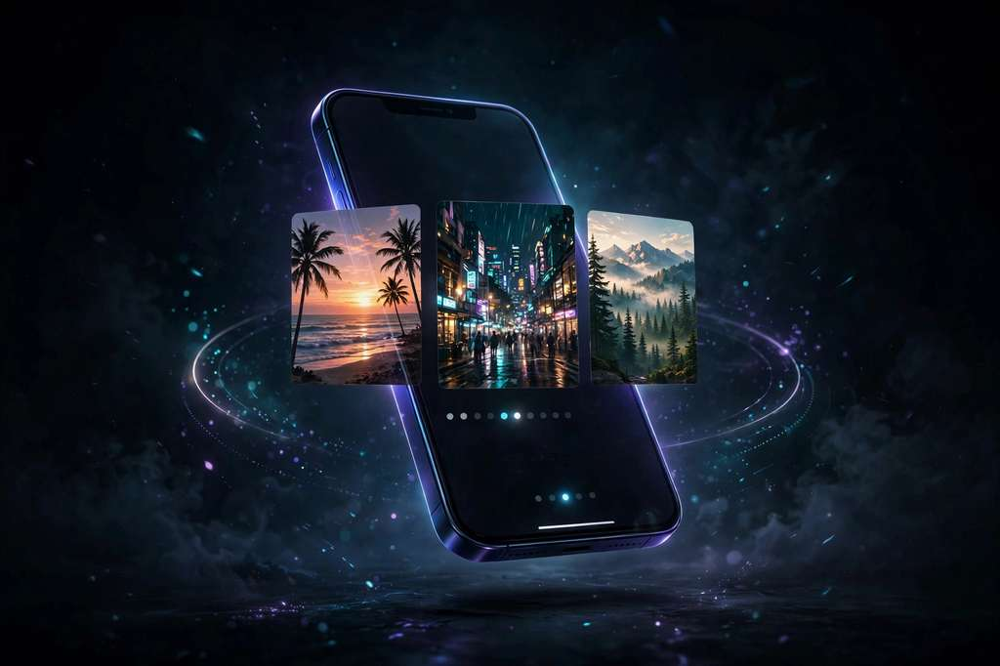

# LivePhotoConvert — Video to Live Photo Converter

**Trim here. Create there. A clear path from video to Live Photo.**

网页本地剪辑短视频片段 → 用 All To Live iPhone 应用生成实况照片 · 不上传 · 免费使用

Free to use

Independent web tool. The page trims video locally in your browser — nothing is uploaded. Safari cannot create a Live Photo, so the final native step runs in the All To Live iPhone app. Concept artwork on this page illustrates the idea, not a result.

## Links

|  | URL |
| --- | --- |
| **App** | https://livephotoconvert.com |
| **This landing** | https://majiatools.github.io/live-photo-convert/ |

## What it does

- **Local video trimmer**: choose a short moment (1–5 seconds), set its start point and duration, and download a new **MP4** — all inside the browser
- **No upload** — the source video stays in your tab; the new MP4 is created on your device with its audio kept
- Accepts MP4, MOV, and WebM; short H.264 MP4/MOV clips under 35 MB work best
- **Finish in All To Live** (iPhone app): pick the MP4 from Files, create the Live Photo, refine its cover frame, save it to your photo library
- Also works as a standalone short-clip trimmer if you only need the MP4

## How to use

1. Open https://livephotoconvert.com and choose a video from your device
2. Set the start point and motion length (1–5 seconds), then download the trimmed MP4 to Files
3. Open All To Live on iPhone, choose that MP4, and create your Live Photo

## License

Demo media for product showcase. Site © lynsea.
